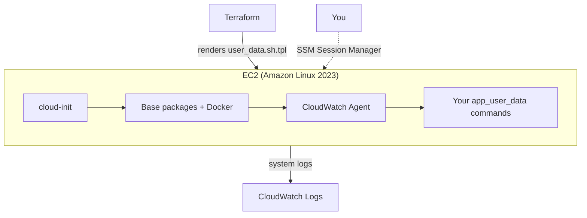

# terraform-aws-ec2-userdata

Terraform that provisions a single EC2 instance with a parameterized user data (cloud-init) bootstrap script: base packages, Docker, and the CloudWatch Agent are always installed, and you supply your own application startup commands through one variable.

## Architecture



## What gets created

| Resource | Purpose |
|---|---|
| `aws_instance` | Amazon Linux 2023 host, IMDSv2 required, encrypted gp3 root volume |
| `aws_security_group` + rules | Ingress on `app_port` only from `allowed_cidr_blocks` |
| `aws_iam_role` + instance profile | `AmazonSSMManagedInstanceCore` (shell access without SSH) and `CloudWatchAgentServerPolicy` |
| `aws_cloudwatch_log_group` | Destination for `/var/log/messages`, shipped by the CloudWatch Agent |
| `user_data` (rendered from `user_data.sh.tpl`) | Installs Docker + CloudWatch Agent, then runs whatever you pass in `app_user_data` |

## Prerequisites

- Terraform 1.6 or newer
- An existing VPC and subnet (see [terraform-aws-vpc](https://github.com/metalaranna/terraform-aws-vpc) if you need one)
- AWS credentials with permission to create EC2, IAM, and CloudWatch Logs resources

## Quick start

```bash
git clone https://github.com/metalaranna/terraform-aws-ec2-userdata.git
cd terraform-aws-ec2-userdata

cp terraform.tfvars.example terraform.tfvars
# Edit vpc_id, subnet_id, allowed_cidr_blocks, and app_user_data

terraform init
terraform plan
terraform apply
```

Open a shell without SSH:

```bash
$(terraform output -raw ssm_session_command)
```

## Configuration

| Variable | Default | Description |
|---|---|---|
| `vpc_id` / `subnet_id` | required | Where to place the instance |
| `allowed_cidr_blocks` | required | CIDRs allowed to reach `app_port`. `0.0.0.0/0` is rejected by a validation rule |
| `app_port` | `8080` | Port your application listens on |
| `instance_type` | `t3.micro` | EC2 instance type |
| `root_volume_size_gb` | `20` | Encrypted root volume size |
| `associate_public_ip` | `true` | Assign a public IP |
| `packages` | `[]` | Extra `dnf` packages to install, beyond Docker + CloudWatch Agent |
| `app_user_data` | placeholder comment | Shell commands appended after the base bootstrap — this is where your `docker run`, `git clone && make deploy`, or similar goes |
| `enable_detailed_monitoring` | `false` | EC2 1-minute CloudWatch monitoring (small extra cost) |
| `tags` | `{}` | Extra tags |

## How the user data template works

`user_data.sh.tpl` is rendered with Terraform's `templatefile()` function. The base script:

1. Updates packages and installs Docker plus anything listed in `packages`
2. Enables Docker and adds `ec2-user` to the `docker` group
3. Configures and starts the CloudWatch Agent to ship `/var/log/messages`
4. Appends the raw string from `app_user_data` as the final step

This keeps the "platform" bootstrap (Docker, logging, IAM-backed access) separate from "your application," so you can reuse this repo across different apps by only changing `app_user_data` and `app_port`.

## Design notes / trade-offs

- **No SSH.** Access is through SSM Session Manager, which is logged in CloudTrail. If you need SSH anyway, add a key pair and port-22 ingress rule yourself — it's intentionally left out here.
- **`user_data_replace_on_change = true`** means changing `app_user_data` (or anything else that feeds the template) replaces the user data and triggers a full instance replacement on the next apply, rather than silently leaving the old bootstrap in place. That's usually what you want for a script-driven instance like this; if you'd rather patch a running instance, do it out of band (SSM Run Command, for example) instead of through `app_user_data`.
- **`/var/log/messages` is a starting point**, not a complete logging strategy — extend the CloudWatch Agent config in the template if your app writes its own log files.

## Cost

One EC2 instance plus its EBS volume, and CloudWatch Logs ingestion for system logs. Check current [EC2 pricing](https://aws.amazon.com/ec2/pricing/) for your region.

## Cleanup

```bash
terraform destroy
```

## Development

```bash
terraform fmt -recursive
terraform init -backend=false
terraform validate
```

The same checks run in GitHub Actions on every push and pull request.

## License

MIT. See [LICENSE](LICENSE).
